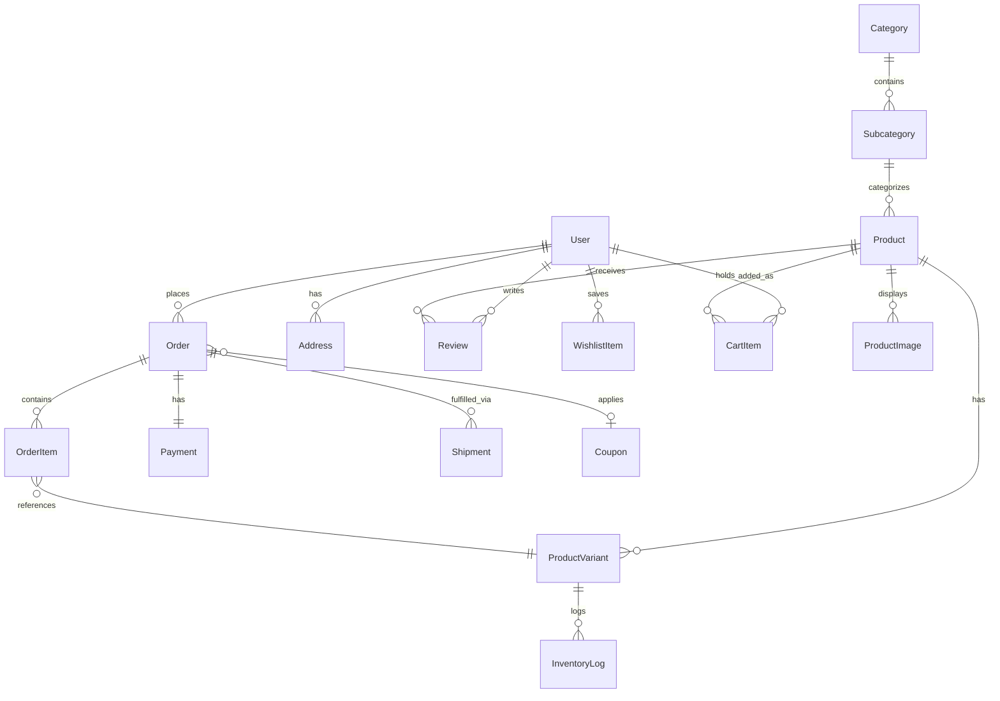

# TiniWish — System Architecture Document

> **Brand**: TiniWish  
> **Tagline**: *"Little wishes. Timeless treasures."*  
> **Domain**: Premium Indian B2C E-Commerce  
> **Architecture Style**: Modular Monolith  
> **Version**: 1.0.0-draft  
> **Last Updated**: 2026-11-07  

---

## 1. Executive Summary & Architectural Principles

TiniWish is a production-grade, luxury B2C e-commerce platform built for the Indian market, specializing in:
1. **Artificial Jewellery** (Kundan, Polki, American Diamond, temple jewellery, daily-wear minimal pieces)
2. **Charming Gifts** (Curated hampers, personalized keepsakes, anniversary & festive gifts)
3. **Timeless Home Décor** (Artisanal brassware, marble accents, luxury candles, handcrafted wall art)

### Core Architectural Principles

- **Modular Monolith First**: The system avoids distributed microservice overhead. All domains (Catalog, Cart, Checkout, Payments, Fulfillment, Notifications, Admin) exist in a unified Next.js App Router codebase with strict boundary separation through domain service layers.
- **Strict Server-Authoritative Logic**: No prices, discounts, shipping fees, tax rates (GST), or stock counts calculated on the client are ever trusted. All financial calculations occur strictly inside server route handlers and database transactions.
- **Cryptographic Trust**: Payment state transitions are triggered and verified only via cryptographic webhook signatures (Razorpay HMAC-SHA256) or verified server-to-server API calls.
- **ACID Integrity & Concurrency Control**: Critical checkout and inventory operations use PostgreSQL transactions via Prisma to eliminate double-selling and race conditions.
- **Mobile-First Luxury Experience**: Designed for sub-second interactions on Indian 4G/5G mobile networks, with fluid typography, responsive image art direction, and accessible UI components conforming to WCAG 2.1 AA standards.

---

## 2. High-Level System Architecture

```
┌─────────────────────────────────────────────────────────────────────────────┐
│                           CLIENT LAYER (Next.js)                           │
│  ┌───────────────────────┐ ┌───────────────────────┐ ┌───────────────────┐  │
│  │  Storefront (SSR/ISR) │ │   Client Components   │ │  Admin Dashboard  │  │
│  │  Playfair / Inter     │ │   Cart, Search, Wish  │ │  (RBAC Protected) │  │
│  └───────────┬───────────┘ └───────────┬───────────┘ └─────────┬─────────┘  │
└──────────────┼─────────────────────────┼───────────────────────┼────────────┘
               │                         │                       │
               ▼                         ▼                       ▼
┌─────────────────────────────────────────────────────────────────────────────┐
│                    API & SERVICE LAYER (Route Handlers)                     │
│  ┌───────────────────────┐ ┌───────────────────────┐ ┌───────────────────┐  │
│  │   Auth & RBAC Guard   │ │   Zod Validation API  │ │ Webhook Listeners │  │
│  │   (Supabase Session)  │ │   (DTO Contracts)     │ │ (Razorpay/Shiprk) │  │
│  └───────────┬───────────┘ └───────────┬───────────┘ └─────────┬─────────┘  │
│              │                         │                       │            │
│              ▼                         ▼                       ▼            │
│  ┌───────────────────────────────────────────────────────────────────────┐  │
│  │                       DOMAIN SERVICE MODULES                          │  │
│  │  [ProductService]   [CartService]      [OrderService]   [AdminService]│  │
│  │  [PricingEngine]    [InventoryEngine]  [PaymentGateway] [ShipGateway] │  │
│  └─────────────────────────────────────┬─────────────────────────────────┘  │
└────────────────────────────────────────┼────────────────────────────────────┘
                                         │
               ┌─────────────────────────┼─────────────────────────┐
               │                         │                         │
               ▼                         ▼                         ▼
┌───────────────────────────┐ ┌───────────────────┐ ┌─────────────────────────┐
│     PERSISTENCE LAYER     │ │   STORAGE LAYER   │ │   EXTERNAL GATEWAYS     │
│  Supabase PostgreSQL      │ │   Cloudflare R2   │ │   • Razorpay (Pay/COD)  │
│  Prisma ORM (Schema/Pool) │ │   S3-compatible   │ │   • Shiprocket (Logist) │
│  Row-Level Security       │ │   Zero-Egress CDN │ │   • Resend (Email/SMTP) │
└───────────────────────────┘ └───────────────────┘ └─────────────────────────┘
```

---

## 3. Technology Stack & Decision Matrix

| Layer | Technology | Decision Rationale |
| :--- | :--- | :--- |
| **Framework** | Next.js 15+ (App Router) | Server Components for SEO and fast TTFB, Server Actions/Route Handlers for API layer, built-in image optimization. |
| **Language** | TypeScript (Strict Mode) | Type safety across database schema, API contracts, and UI components; runtime bugs prevented at compile-time. |
| **Styling** | Tailwind CSS v4 | Utility-first styling with custom design tokens matching the TiniWish luxury palette (Ivory, Champagne, Muted Gold). |
| **Component Library** | shadcn/ui + Radix UI Primitives | Accessible, unstyled headless primitives styled with Tailwind; complete ownership of code without external runtime bloat. |
| **Database** | Supabase (PostgreSQL 16) | Enterprise-grade relational integrity, native JSONB support, connection pooling via PgBouncer / Supavisor. |
| **ORM** | Prisma ORM | Type-safe query building, automatic migration generation, transaction support, and declarative schema modeling. |
| **Authentication** | Supabase Auth | Secure session handling, email/password, OTP, social auth (Google), and JWT verification in Next.js middleware. |
| **Object Storage** | Cloudflare R2 | Zero egress fees, high-speed edge delivery, S3-compatible API for product photography and user review uploads. |
| **Payment Gateway** | Razorpay (India) | Native UPI, Credit/Debit cards, NetBanking, Wallets, EMI, and Cash on Delivery (COD) verification with webhook signature verification. |
| **Logistics/Shipping** | Shiprocket API | Automated courier assignment (BlueDart, Delhivery, DTDC), PIN code serviceability checks, automated AWB generation, and real-time tracking webhooks. |
| **Transactional Email** | Resend + React Email | High deliverability, type-safe HTML email templates for order confirmations, shipping updates, and receipts. |
| **Validation** | Zod | Single source of truth for runtime validation on client forms and backend route handlers. |
| **Testing** | Vitest + Playwright | Vitest for lightning-fast unit and service logic tests; Playwright for cross-browser end-to-end shopping & checkout flows. |
| **Hosting & CI/CD** | Vercel | Native Next.js edge caching, preview deployments, automatic SSL, and zero-configuration serverless infrastructure. |

---

## 4. Design Identity & Luxury Theme System

TiniWish positions itself as an accessible luxury brand. The visual design avoids gaudy golds, choosing refined, warm, and tactile tones.

### Color Palette Tokens

```css
:root {
  /* Primary Brand Neutrals */
  --tw-ivory: #FDFBF7;        /* Main background */
  --tw-ivory-soft: #F9F6F0;   /* Secondary surface / cards */
  --tw-warm-beige: #EFE9DF;   /* Borders, dividers, subtle chips */
  
  /* Luxury Accents */
  --tw-champagne: #E6D7C3;    /* Highlight fills, subtle cards */
  --tw-champagne-light: #F4ECE1;
  --tw-muted-gold: #C5A880;   /* Brand accent, buttons, focus rings */
  --tw-gold-dark: #A38458;    /* Interactive hover states */
  --tw-gold-deep: #7D633E;    /* Deep contrast gold */

  /* Typography Colors */
  --tw-charcoal: #262422;     /* Primary text for ultra-clear legibility */
  --tw-stone: #595550;        /* Secondary/muted text */
  --tw-stone-light: #8C867E;   /* Placeholder & metadata text */

  /* Feedback & Semantics */
  --tw-error: #B94A48;
  --tw-success: #3F704D;
  --tw-warning: #C27D38;
}
```

### Typography Hierarchy

- **Display & Headings**: `Playfair Display`, serif, with delicate font weights (400, 500, 600) and spacious letter-spacing (`tracking-tight` to `tracking-wide`).
- **Body & Functional UI**: `Inter`, sans-serif, optimized for readability on small mobile screens with tabular figures (`tabular-nums`) for prices and monetary values.

---

## 5. Directory Structure & Architecture Boundaries

The codebase follows a strictly organized modular structure:

```
tiniwish/
├── .github/                   # CI/CD Workflows (lint, test, build)
├── prisma/
│   ├── schema.prisma          # Database schema definitions
│   ├── seed.ts                # Database seed data (categories, initial products)
│   └── migrations/            # SQL migration history
├── public/                    # Static assets, brand logos, favicons
├── src/
│   ├── app/                   # Next.js App Router
│   │   ├── (storefront)/      # Customer-facing route group
│   │   │   ├── layout.tsx     # Header, announcement bar, footer
│   │   │   ├── page.tsx       # Homepage (Hero, Categories, Best Sellers, Story)
│   │   │   ├── jewellery/     # Category: Artificial Jewellery
│   │   │   ├── gifts/         # Category: Charming Gifts
│   │   │   ├── home-decor/    # Category: Timeless Home Décor
│   │   │   ├── products/
│   │   │   │   └── [slug]/    # Product detail page (PDP)
│   │   │   ├── cart/          # Cart overview & gift wrapping options
│   │   │   ├── checkout/      # Multi-step checkout & payment
│   │   │   ├── order-success/ # Order confirmation & invoice download
│   │   │   ├── track-order/   # Real-time order tracking
│   │   │   ├── wishlist/      # User wishlist
│   │   │   └── account/       # Customer profile, orders, addresses
│   │   ├── (auth)/            # Auth routes (login, register, forgot-password)
│   │   ├── admin/             # Admin portal (protected by role)
│   │   │   ├── layout.tsx     # Admin sidebar, header, role check
│   │   │   ├── page.tsx       # KPI Dashboard & metrics
│   │   │   ├── products/      # Inventory, variants, R2 media upload
│   │   │   ├── orders/        # Order fulfillment, AWB generation, refunds
│   │   │   ├── coupons/       # Discount codes & promo rules
│   │   │   ├── customers/     # Customer list & purchase history
│   │   │   └── settings/      # Shipping rules, tax rates, store configs
│   │   └── api/               # Server Route Handlers
│   │       ├── auth/          # Supabase auth hooks & session sync
│   │       ├── checkout/      # Order creation & pricing validation
│   │       ├── payments/      # Razorpay order generation & verification
│   │       ├── webhooks/      # Razorpay & Shiprocket signature listeners
│   │       ├── shipping/      # Pincode serviceability & rates
│   │       ├── reviews/       # Verified buyer ratings & reviews
│   │       └── admin/         # Secure management endpoints
│   ├── components/            # Reusable UI components
│   │   ├── ui/                # Base shadcn/ui components (button, dialog, input...)
│   │   ├── storefront/        # Storefront components (ProductCard, Hero, Nav)
│   │   ├── product/           # PDP gallery, variant selector, reviews
│   │   ├── cart/              # Cart drawer, cart line items, gift message modal
│   │   ├── checkout/          # Address form, Razorpay trigger, COD validator
│   │   ├── admin/             # Admin tables, forms, stat cards, metric charts
│   │   └── shared/            # Common badges, price display, loaders
│   ├── lib/                   # Shared singletons & infrastructure clients
│   │   ├── prisma.ts          # Prisma client instance with connection pooling
│   │   ├── supabase/          # Supabase client (client & server middleware)
│   │   ├── razorpay.ts        # Razorpay SDK instance & signature validator
│   │   ├── shiprocket.ts      # Shiprocket API client & auth token cache
│   │   ├── resend.ts          # Resend client for transactional emails
│   │   ├── r2.ts              # Cloudflare R2 S3 client for media storage
│   │   └── utils.ts           # Formatters (INR, dates, slugifiers)
│   ├── services/              # Domain Business Logic (Pure Services)
│   │   ├── product.service.ts # Product & variant querying with cache
│   │   ├── pricing.service.ts # Indian GST, coupon discounts, shipping calc
│   │   ├── inventory.service.ts # Stock decrement & lock checks
│   │   ├── order.service.ts   # Order lifecycle, status machines, invoices
│   │   ├── payment.service.ts # Signature verification, refund requests
│   │   ├── shipping.service.ts# Pincode validation, AWB generation
│   │   └── email.service.ts   # React Email rendering & delivery triggers
│   ├── types/                 # Shared TypeScript interfaces & DTOs
│   │   ├── database.ts        # Inferred Prisma models & extensions
│   │   ├── api.ts             # API response wrappers & error schemas
│   │   └── store.ts           # Client state interfaces
│   └── validators/            # Zod validation schemas
│       ├── checkout.schema.ts # Address, payment mode, coupon schemas
│       ├── product.schema.ts  # Admin product/variant creation schemas
│       └── auth.schema.ts     # Login, signup, password reset schemas
├── tests/
│   ├── unit/                  # Vitest unit tests (pricing, discounts, GST)
│   ├── integration/           # API route & service tests
│   └── e2e/                   # Playwright end-to-end tests (checkout flow)
├── tailwind.config.ts         # Tailwind configuration & luxury color tokens
├── tsconfig.json              # Strict TypeScript settings
└── package.json
```

---

## 6. Database Schema (Prisma / PostgreSQL)

### Entity-Relationship Diagram



### Core Data Models Definition

1. **User & Profile**: Stores Supabase Auth UID mapping, role (`CUSTOMER`, `ADMIN`, `SUPPORT`), phone, email, and loyalty status.
2. **Address**: Normalized Indian address structure: `addressLine1`, `addressLine2`, `landmark`, `city`, `state`, `pincode`, `phone`, `isDefaultShipping`, `isDefaultBilling`.
3. **Category & Subcategory**:
   - `JEWELLERY`: Necklaces, Earrings, Bangles, Rings, Jewellery Sets.
   - `GIFTS`: For Her, For Him, Personalized Keepsakes, Hampers, Festive Specials.
   - `HOME_DECOR`: Brass Accents, Luxury Candles, Vases & Planters, Wall Décor.
4. **Product & ProductVariant**:
   - `Product`: Title, slug, description, care instructions, materials, base price, tags, SEO meta, published status.
   - `ProductVariant`: SKU, title, variant attributes (Color, Size, Material), price, compareAtPrice (MRP), costPrice, weightGrams, dimensions (L, W, H for Shiprocket volumetric weight), stockQuantity, lowStockThreshold.
5. **Order & OrderItem**:
   - `Order`: Order number (`TW-YYYY-XXXXX`), customer ID, status (`PENDING_PAYMENT`, `PAID`, `PROCESSING`, `SHIPPED`, `DELIVERED`, `CANCELLED`, `REFUNDED`), subtotal, discountAmount, gstAmount, shippingFee, totalAmount, paymentMethod (`RAZORPAY`, `COD`), giftWrapping (boolean), giftMessage (text).
   - `OrderItem`: Snapshot of variant SKU, title, unit price, quantity, total price, and gift personalization notes at moment of purchase.
6. **Payment & Transaction**:
   - Razorpay Order ID, Razorpay Payment ID, Razorpay Signature, payment status, raw webhook event payloads for auditability.
7. **Shipment & Tracking**:
   - Shiprocket Order ID, Shiprocket Shipment ID, AWB Code, Courier Name, Current Status, Tracking History JSON, estimated delivery date.
8. **Coupon & Discount Rule**:
   - Code, discount type (`PERCENTAGE`, `FIXED_AMOUNT`), minimum cart value, max discount cap, start date, expiration date, usage limit, per-user limit.

---

## 7. Financial & Checkout Architecture

### 1. Indian GST Compliance & Pricing Engine
- Indian tax calculation must account for different product categories:
  - Artificial Jewellery: 3% GST or 18% GST (based on composition / gold-plated brass rules).
  - Home Décor & Gifts: 12% to 18% GST.
- Prices shown on customer storefront are **GST Inclusive (MRP)** to avoid checkout surprise drop-offs.
- The `PricingEngine` accurately deconstructs the invoice:
  $$\text{Taxable Value} = \frac{\text{Gross Price}}{1 + \text{GST Rate}}$$
  $$\text{GST Amount} = \text{Gross Price} - \text{Taxable Value}$$
- Generates intra-state (CGST + SGST) or inter-state (IGST) split based on shipping state vs. business registration state (e.g., Delhi, Maharashtra, Karnataka).

### 2. Currency Formatting
- Standard Indian currency formatting with commas according to Indian numbering system (e.g., ₹1,49,999) using `Intl.NumberFormat('en-IN', { style: 'currency', currency: 'INR', maximumFractionDigits: 0 })`.

### 3. Razorpay Payment Flow & Webhook Verification
1. **Initiation**: User confirms cart -> Backend validates stock and totals -> creates Razorpay Order with amount in paise (`amount * 100`) -> returns `order_id` to client.
2. **Client Modal**: Razorpay checkout script renders UPI / Cards / Netbanking options.
3. **Verification**:
   - Upon completion, client submits `razorpay_order_id`, `razorpay_payment_id`, and `razorpay_signature`.
   - Backend computes HMAC-SHA256:
     $$\text{Expected Signature} = \text{HMAC-SHA256}(\text{order\_id} + "|" + \text{payment\_id}, \text{RAZORPAY\_KEY\_SECRET})$$
   - If verified, order is marked `PAID` within a database transaction, stock is decremented, and an invoice is generated.
4. **Idempotent Webhooks**: If client drops connection before verification callback finishes, the Razorpay `payment.captured` webhook processes the order idempotently without double-charging or duplicate record creation.

### 4. Cash on Delivery (COD) Rules
- COD availability checked against Shiprocket pincode serviceability API.
- COD convenience charge (e.g., flat ₹50 or ₹99) configurable in store settings.
- Maximum COD order limit (e.g., ₹5,000) to limit transit return (RTO) risk.
- Optional OTP / SMS / WhatsApp verification prior to confirming COD orders.

---

## 8. Logistics & Fulfillment Architecture (Shiprocket)

1. **Pre-Purchase Serviceability Check**:
   - User inputs 6-digit Indian PIN code on PDP or Checkout.
   - Cached lookup against Shiprocket Serviceability API returns:
     - Delivery availability (Prepaid vs COD)
     - Estimated delivery days (e.g., 2–4 business days)
     - Recommended courier (BlueDart, Delhivery, ExpressBees)
2. **Post-Purchase Fulfillment Flow**:
   - Admin approves order -> Backend calls Shiprocket `adhoc/orders/create` with customer address, item weights, and HSN codes.
   - Shiprocket generates `shipment_id`.
   - Admin generates AWB & assigns courier with one click in the Admin portal.
   - Generates printable Shipping Label and Manifest.
3. **Automated Tracking Updates**:
   - Shiprocket tracking webhooks (`pickup_scheduled`, `in_transit`, `out_for_delivery`, `delivered`, `rto_initiated`) update order state in real time.
   - Triggers customer notifications (Email via Resend / SMS).

---

## 9. Security & Access Control

- **Role-Based Access Control (RBAC)**:
  - Roles: `CUSTOMER`, `SUPPORT`, `ADMIN`.
  - Next.js Middleware checks Supabase JWT session claims for protected routes (`/admin/*`, `/api/admin/*`).
- **Input Sanitization & Validation**:
  - All incoming payload parsed through strict Zod schemas with `.strip()` or `.strict()` to prevent prototype pollution and parameter tampering.
- **Secret Hygiene**:
  - `NEXT_PUBLIC_` prefix strictly limited to non-sensitive keys (`NEXT_PUBLIC_SUPABASE_URL`, `NEXT_PUBLIC_SUPABASE_ANON_KEY`, `NEXT_PUBLIC_RAZORPAY_KEY_ID`).
  - All secret keys (`RAZORPAY_KEY_SECRET`, `SHIPROCKET_PASSWORD`, `RESEND_API_KEY`, `CLOUDFLARE_R2_SECRET_ACCESS_KEY`, `DATABASE_URL`) accessible only in Node.js server environments.
- **CSRF & Rate Limiting**:
  - Route handlers implement rate limiting for sensitive endpoints (OTP requests, login attempts, coupon validation) using sliding window counters.

---

## 10. Quality Assurance & Performance Strategy

- **Core Web Vitals Targets**:
  - Largest Contentful Paint (LCP) $\le 2.0\text{s}$
  - Cumulative Layout Shift (CLS) $\le 0.05$
  - Interaction to Next Paint (INP) $\le 100\text{ms}$
- **Image Optimization**:
  - High-res product images hosted on Cloudflare R2.
  - Served via Next.js `<Image>` component with AVIF/WebP formats, responsive `sizes`, and blur-up placeholder data URLs.
- **Testing Pyramid**:
  - **Unit Tests (Vitest)**: Pricing engine, GST calculators, coupon validation, inventory stock locks.
  - **Integration Tests (Vitest)**: API Route handlers (Cart, Checkout, Payment Webhooks).
  - **E2E Tests (Playwright)**: Full customer journey (Home -> Search -> Filter -> PDP -> Cart -> Checkout -> Payment verification -> Order confirmation).

