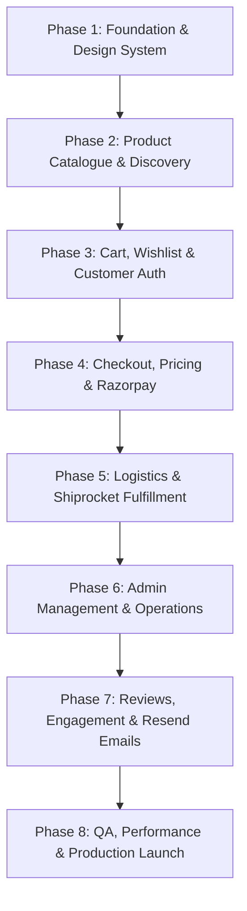

# TiniWish — Comprehensive Project Plan & Implementation Roadmap

> **Brand**: TiniWish  
> **Tagline**: *"Little wishes. Timeless treasures."*  
> **Scope**: End-to-End Production B2C E-Commerce Platform  
> **Target Launch**: Production-Ready  
> **Version**: 1.0.0  

---

## 1. Project Vision & Goals

TiniWish is an Indian luxury e-commerce brand curating exquisite artificial jewellery, heartwarming gifts, and timeless home décor. The objective is to engineer a blazing-fast, secure, and visually breathtaking shopping experience that rivals top-tier luxury brands like Tanishq, Forest Essentials, and Nicobar, while maintaining uncompromising engineering standards:
- **Zero Financial Discrepancies**: 100% server-validated pricing, tax (GST), and discounts.
- **Flawless Payment Workflows**: End-to-end Razorpay integration with automatic webhook reconciliation for drop-offs and network interruptions.
- **Logistics Automation**: Pre-purchase PIN code delivery estimates and post-purchase automated fulfillment via Shiprocket.
- **High-Converting UX**: Fast page loads (< 2s LCP), mobile-first design, intuitive gift customization, and seamless checkout.

---

## 2. Phased Implementation Roadmap

---

### Phase 1: Foundation, Design System & Core Setup

**Objective**: Establish the project boilerplate, strict compiler configurations, luxury design tokens, component primitives, and relational database schema.

- [ ] **Task 1.1: Project Initialization & Strict Tooling**
  - Initialize Next.js 15+ App Router with TypeScript in strict mode.
  - Configure ESLint, Prettier, and path aliases (`@/*`).
  - Set up Vitest and Playwright test runners.
  - Setup environment variables template (`.env.example`).
- [ ] **Task 1.2: Design System & Luxury Theme Configuration**
  - Install and configure Tailwind CSS v4 with custom luxury brand palette:
    - Ivory (`#FDFBF7`), Ivory Soft (`#F9F6F0`), Warm Beige (`#EFE9DF`)
    - Champagne (`#E6D7C3`), Muted Gold (`#C5A880`), Gold Dark (`#A38458`)
    - Charcoal (`#262422`), Stone (`#595550`)
  - Configure typography with `Playfair Display` (serif) for headings and `Inter` (sans-serif) for body and numerical data.
  - Setup base shadcn/ui components (`Button`, `Input`, `Dialog`, `Sheet`, `DropdownMenu`, `Tabs`, `Skeleton`, `Toast`).
- [ ] **Task 1.3: Database Modeling & Supabase / Prisma Setup**
  - Configure Prisma schema with models: `User`, `Address`, `Category`, `Subcategory`, `Product`, `ProductVariant`, `ProductImage`, `Cart`, `CartItem`, `WishlistItem`, `Order`, `OrderItem`, `Payment`, `Shipment`, `Coupon`, `Review`.
  - Connect to Supabase PostgreSQL database.
  - Create database migration and seeding scripts with realistic catalog data for Artificial Jewellery, Gifts, and Home Décor.

---

### Phase 2: Product Catalogue & Discovery Engine

**Objective**: Build a lightning-fast, high-converting product browsing and discovery experience.

- [ ] **Task 2.1: Navigation & Storefront Shell**
  - Implement luxury announcement bar (offers, free shipping over ₹999).
  - Design sticky header with category dropdowns, currency display (₹ INR), search bar trigger, wishlist count, and cart drawer trigger.
  - Build responsive mobile drawer navigation with smooth slide-in transitions.
  - Implement comprehensive luxury footer with trust badges, brand story, policies, and newsletter signup.
- [ ] **Task 2.2: Homepage Experience**
  - Hero banner with editorial photography and call-to-action buttons.
  - Featured 3-pillar category showcases:
    1. *Artificial Jewellery* (Kundan, Polki, American Diamond, Daily Elegance)
    2. *Charming Gifts* (Hampers, Keepsakes, Personalized Presents)
    3. *Timeless Home Décor* (Brassware, Handcrafted Vases, Luxury Accents)
  - Curated collections: "New Arrivals", "Best Sellers", "Gifting Under ₹1,999".
  - Brand heritage and artisan craftsmanship story section.
  - Customer testimonial and Instagram curated gallery carousel.
- [ ] **Task 2.3: Category & Collection Listing Pages**
  - Server-side rendered category pages (`/jewellery`, `/gifts`, `/home-decor`).
  - Faceted filters (Subcategory, Price Range, Material/Finish, Occasion, In-Stock only).
  - Sorting (Featured, Price: Low to High, Price: High to Low, Newest Arrivals, Customer Rating).
  - Responsive product cards with image hover secondary view, quick-view modal, discount badge, and one-click wishlist toggle.
- [ ] **Task 2.4: Search & Autocomplete**
  - Debounced real-time search with instant dropdown preview showing matching products, categories, and recent searches.
  - Dedicated search results page with filter preservation.
- [ ] **Task 2.5: Product Detail Page (PDP)**
  - Multi-image gallery with zoom-on-hover and mobile thumbnail swipe.
  - Variant selector (Metal finish: Gold, Silver, Rose Gold; Size / Chain length).
  - Dynamic pricing (MRP vs Discounted Selling Price, showing % savings).
  - Indian PIN code delivery checker with estimated arrival date (e.g., "Delivery by Thursday, 12 Nov").
  - Gift box & custom engraving toggle.
  - Accordion for "Product Details", "Materials & Care Instructions", and "Shipping & Returns".
  - Related products carousel ("Complete the Look" / "Frequently Bought Together").

---

### Phase 3: Cart, Wishlist & Customer Authentication

**Objective**: Build persistent, high-utility shopping cart, wishlist, and frictionless customer accounts.

- [ ] **Task 3.1: Slide-Out Cart Drawer & Full Cart Page**
  - Instant optimistic cart drawer updates.
  - Quantity increment/decrement with real-time server inventory limits check.
  - Order-level gift options: Luxury gift packaging (₹99) and personalized handwritten message card (Complimentary).
  - Free shipping progress bar (e.g., "Add ₹340 more to unlock Free Express Shipping").
  - Order summary breakdown: Subtotal, Estimated Tax (GST), Shipping fee, and Total.
- [ ] **Task 3.2: Wishlist Functionality**
  - Persistent wishlist stored in local storage for guest shoppers.
  - Automatic synchronization with Supabase customer account upon login.
  - One-click "Move to Cart" with variant picker if required.
- [ ] **Task 3.3: Customer Authentication & Account Portal**
  - Supabase Auth integration (Email/Password, Magic Link OTP, Google OAuth).
  - Customer account dashboard:
    - Order history with live status badges.
    - Saved addresses manager (Add, Edit, Set Default Shipping/Billing).
    - Profile settings & phone number verification.
    - Password management.

---

### Phase 4: Checkout, Pricing Engine & Razorpay Integration

**Objective**: Engineer an airtight, secure, and intuitive checkout experience with multi-method payment support.

- [ ] **Task 4.1: Multi-Step Luxury Checkout**
  - Step 1: Customer Contact & Indian Shipping Address (Autofill State and City from 6-digit PIN code).
  - Step 2: Shipping Method (Standard Free Shipping vs Express Delivery).
  - Step 3: Payment Method Selection (Razorpay UPI/Cards/Netbanking or Cash on Delivery).
- [ ] **Task 4.2: Server-Side Pricing Engine**
  - Server calculation of line items, variant prices, and quantities.
  - Indian GST breakdown (Taxable value + CGST/SGST or IGST).
  - Promotional coupon engine (validates expiry, min cart value, usage limits, user eligibility).
  - Applied coupon discount deduction with clear error messaging for invalid codes.
- [ ] **Task 4.3: Razorpay Payment Processing**
  - Razorpay Order API integration with amount converted to paise.
  - Razorpay Standard Checkout modal integration with TiniWish luxury branding (colors, logo).
  - Server-side cryptographic signature verification (`HMAC-SHA256`).
  - Webhook listener (`/api/webhooks/razorpay`) to capture asynchronous payments (`payment.captured`, `payment.failed`).
- [ ] **Task 4.4: Cash on Delivery (COD) Engine**
  - Eligibility check: Order value within allowed threshold (e.g., ₹500 - ₹5,000) and PIN code serviceability.
  - Optional COD handling charge calculation.
  - Order creation in `PENDING_VERIFICATION` or `PAID_ON_DELIVERY` state.
- [ ] **Task 4.5: Order Confirmation & Invoice Generation**
  - Post-checkout order success screen with order reference, itemized summary, delivery timeline, and WhatsApp/Email confirmation alerts.
  - PDF/HTML invoice generation with GSTIN, HSN codes, and registered business address.

---

### Phase 5: Logistics & Shiprocket Fulfillment

**Objective**: Connect warehouse operations and provide real-time shipping transparency to customers.

- [ ] **Task 5.1: Shiprocket Client & Serviceability Engine**
  - Secure authentication token caching with auto-refresh.
  - PIN code serviceability query (`/courier/serviceability`) returning available couriers, ETAs, and COD availability.
- [ ] **Task 5.2: Automated Order Fulfillment**
  - Push confirmed orders to Shiprocket with dimensions, volumetric weight, and customer contact.
  - One-click AWB generation and courier assignment from Admin portal.
  - Shipping label & manifest download generation.
- [ ] **Task 5.3: Post-Purchase Real-Time Order Tracking**
  - Customer-facing track order portal (`/track-order`) querying by Order ID or AWB number.
  - Interactive status timeline (Ordered -> Packed -> Shipped -> Out for Delivery -> Delivered).
  - Webhook listener (`/api/webhooks/shiprocket`) to automatically update database shipment status.

---

### Phase 6: Admin Dashboard & Operations

**Objective**: Provide business managers with complete operational oversight and inventory control.

- [ ] **Task 6.1: Role-Based Admin Portal**
  - Protected route guard (`/admin/*`) restricted to users with `ADMIN` role.
  - Executive overview dashboard: Revenue metrics, total orders, average order value (AOV), inventory alert counts, and recent order stream.
- [ ] **Task 6.2: Product & Catalog Management**
  - Comprehensive Product CRUD interface.
  - Multi-variant configuration (SKU, MRP, Selling Price, Cost, Stock, Attributes).
  - Cloudflare R2 image uploader with drag-and-drop, reordering, and alt-text tags.
  - Category, subcategory, and tag assignment.
- [ ] **Task 6.3: Inventory & Stock Controls**
  - Real-time stock audit table with low-stock badges.
  - Stock adjustment logger (Manual Adjustment, Purchase Order, Return, Damage).
- [ ] **Task 6.4: Order Management & Customer Service**
  - Searchable order table with filters (Status, Date range, Payment method, Customer).
  - Order detail inspection (Customer info, items ordered, payment transaction ID, Shiprocket AWB).
  - Status management (Mark as Packed, Ship, Cancel, Trigger Razorpay Refund).
- [ ] **Task 6.5: Marketing & Coupon Engine**
  - Create and manage discount codes (Percentage, Flat Off, Free Shipping).
  - Set usage thresholds (Minimum order amount, maximum discount cap, total redemption count, validity window).

---

### Phase 7: Reviews, Engagement & Transactional Emails

**Objective**: Build social proof and deliver automated customer communication.

- [ ] **Task 7.1: Verified Buyer Reviews & Ratings System**
  - Product rating (1 to 5 stars) with text review and customer photo uploads.
  - "Verified Buyer" badge tied to verified past order records.
  - Review moderation controls in Admin portal.
  - Rating distribution breakdown summary on PDP.
- [ ] **Task 7.2: Resend Email Notifications**
  - React Email luxury branded templates:
    1. Order Confirmation (Itemized receipt, shipping address, estimated delivery).
    2. Shipping Notification (Courier name, AWB code, live tracking link).
    3. Out for Delivery & Delivered alerts.
    4. Password reset & welcome emails.

---

### Phase 8: Quality Assurance, Security & Production Launch

**Objective**: Validate functionality, harden security, optimize performance, and deploy to production.

- [ ] **Task 8.1: Unit & Integration Testing (Vitest)**
  - Pricing calculation unit tests (GST splits, multiple line items, coupon discounts).
  - Inventory reservation and race condition tests.
  - Razorpay cryptographic signature verification tests.
- [ ] **Task 8.2: End-to-End Testing (Playwright)**
  - Customer browsing, search, filter, and PDP variant selection.
  - Add to cart, gift wrapping selection, and cart checkout.
  - Mocked Razorpay payment flow and order success verification.
  - Admin product creation and order status updates.
- [ ] **Task 8.3: Performance & Core Web Vitals Optimization**
  - Next.js dynamic imports for non-critical modals and drawers.
  - Responsive image optimization with proper `sizes` and AVIF format.
  - Lighthouse audit targeting 90+ across Performance, Accessibility, Best Practices, and SEO.
- [ ] **Task 8.4: Production Readiness & Vercel Deployment**
  - Production environment configuration checklist (Supabase, Razorpay live keys, Shiprocket live tokens, Cloudflare R2 bucket, Resend API key).
  - Next.js production build verification (`npm run build`).
  - Canonical domain setup, SSL, robots.txt, and sitemap.xml generation.

---

## 3. Risk Assessment & Mitigation Strategy

| Risk Category | Identified Risk | Impact | Mitigation Strategy |
| :--- | :--- | :--- | :--- |
| **Financial / Payment** | Payment charged to customer, but network drops before client verification callback. | High | Implement asynchronous Razorpay webhooks (`payment.captured`) with database idempotency keys to ensure orders are fulfilled even if client disconnects. |
| **Inventory** | Concurrent checkouts of the last item in stock causing overselling. | High | Wrap order confirmation and stock decrement inside Prisma PostgreSQL serializable/interactive transactions with `SELECT ... FOR UPDATE` semantics. |
| **Logistics** | Shiprocket API downtime or rate-limiting during peak sales. | Medium | Asynchronous queueing for fulfillment sync; graceful fallback to manual AWB booking with retry backoff. |
| **Performance** | High-resolution jewellery photography slowing mobile PDP load times. | High | Serve images through Cloudflare R2 behind edge CDN; generate progressive blurred placeholders and compress to WebP/AVIF using Next.js Image Optimization. |
| **Security** | Price tampering in client-side checkout payload. | Critical | Client payload contains only `variantId` and `quantity`; pricing engine fetches actual prices directly from database on the server. |

---

## 4. Release Gates & Definition of Done

Each phase requires passing the following quality gate before being marked complete:
1. **TypeScript Strict Mode**: Zero compiler warnings or errors (`tsc --noEmit` passes).
2. **Linting & Code Style**: ESLint passes with zero warnings.
3. **Automated Tests**: All unit and integration tests passing.
4. **Visual & UX Polish**: Luxury theme guidelines adhered to; responsive across mobile, tablet, and desktop viewports.
5. **Documentation**: `DEVELOPMENT_STATUS.md` updated with completed deliverables, test results, and any required environment configurations.

